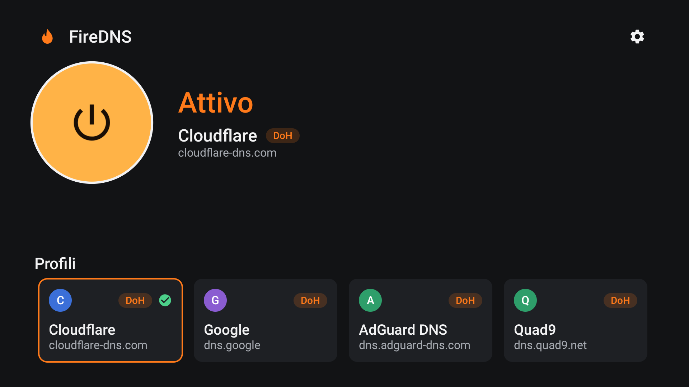
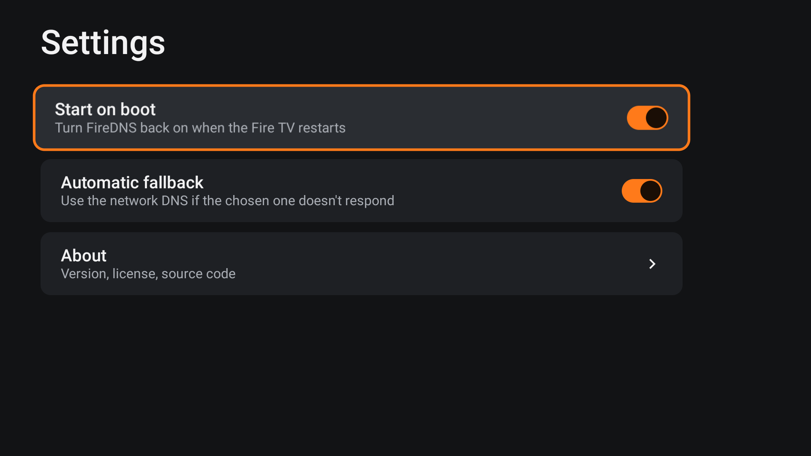
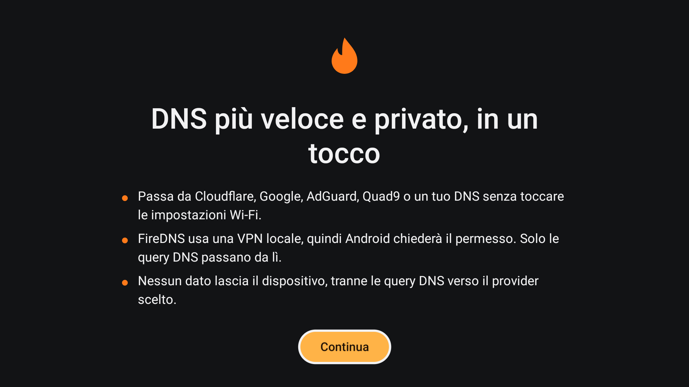

# FireDNS

**Switch DNS on your Fire TV in one click — no need to forget and reconfigure your Wi-Fi.**

FireDNS runs a small **local VPN** that captures only DNS queries and sends them to the provider you pick. Everything else goes straight to your network, untouched.

- **One-click switch** between Cloudflare, Google, AdGuard DNS and Quad9
- **Encrypted DNS** (DNS-over-HTTPS) for all built-in providers
- **Your own DNS**: add NextDNS, Pi-hole or your router by IP address or DoH URL
- **Automatic fallback** to your network DNS if the chosen provider stops answering
- **Starts on boot** and follows Wi-Fi / Ethernet changes
- **Remote-first UI** designed for the D-pad, in English and Italian
- **No accounts, no ads, no tracking**: nothing leaves your device except the DNS queries to the provider you chose

> FireDNS is meant for **privacy, ad/malware blocking and speed**. Use it in compliance with the laws of your country.

## Screenshots

| Home | Settings | First launch |
|---|---|---|
|  |  |  |

## Supported devices

Fire TV devices running **Fire OS 7 or later** (Android 9+): Fire TV Stick 4K Max, 4K, 4K Plus, HD (2024), Fire TV Cube and TVs with Fire TV built in.

**Not supported:** devices running **Vega OS** (Fire TV Stick 4K Select, Fire TV Stick HD 2nd gen), which cannot install Android apps.

**Google TV / Android TV:** it is a standard Android TV app (Android 9+), so it should work, but it has not been tested yet. If you try it, please report back in an issue.

Tested on: Fire TV Stick HD (1st gen), Fire OS 7.7.

## Install

**With Downloader** (recommended):

1. Install [Downloader](https://www.amazon.com/dp/B01N0BP507) from the Amazon Appstore.
2. Go to *Settings → My Fire TV → Developer options → Install unknown apps* and turn it **on for Downloader**.
   If you don't see *Developer options*, open *Settings → My Fire TV → About* and click the device name 7 times.
3. Open Downloader and enter the code:

```
8088747
```

or the full URL, which always points to the latest release:

```
https://github.com/downlevel/firedns/releases/latest/download/firedns.apk
```

**With adb** from a computer on the same network (enable *Settings → My Fire TV → Developer options → ADB debugging* first):

```bash
adb connect <FIRE_TV_IP>:5555
adb install -r firedns.apk
```

Open **FireDNS** from *Your Apps*, press **Continue** and accept Android's VPN permission.

## FAQ

**What do I gain by changing DNS?**
DNS is how your Fire TV finds the address of a service, and by default it uses your internet provider's. With FireDNS you get encrypted lookups, ad and tracker blocking in many apps and websites (*AdGuard DNS*), malware protection (*Quad9*) and sometimes faster loading, if your provider's DNS is slow.

**What is the difference from entering the DNS manually?**
The DNS can be the same, but on Fire TV the manual way means forgetting your Wi-Fi, re-entering the password and typing a static IP, gateway and DNS with the remote, every time you want to switch. FireDNS does it in one click and adds encrypted DNS (DoH) and automatic fallback.

**Why does it need VPN permission?**
Android does not let apps change the Wi-Fi DNS since Android 10. A local VPN is the only way to redirect DNS without root. FireDNS routes only DNS addresses into it: your streams and downloads never pass through the app.

**Does it need to stay running? Can I force close it?**
It needs to stay running: if you force close it, the Fire TV goes back to your network DNS. You don't have to keep the app open, though. It runs as a lightweight background service and starts on boot, so you set it once and forget about it.

**Does it block ads on YouTube, Prime Video, Hotstar…?**
No. Those apps serve ads from the same servers as the video, so no DNS-based blocker (FireDNS, Pi-hole, AdGuard DNS…) can block them without breaking playback. With *AdGuard DNS* FireDNS blocks a lot of ads and trackers in other apps and on websites.

**Does it block the ads on the Fire TV home screen?**
This has not been tested. FireDNS applies whatever your DNS provider blocks, so the result depends on its blocklist. Keep in mind that blocking Amazon domains with a custom blocklist can also break parts of the home screen.

**Does it help with streaming or ISP throttling?**
It does not touch the video traffic, so it won't improve quality by itself. It can help if your ISP interferes at the DNS level or its DNS sends you to a poor streaming server. It won't help if the ISP slows down the traffic itself.

**Can I use NextDNS or my Pi-hole?**
Yes. Press *Add DNS* and enter:
- NextDNS: `https://dns.nextdns.io/<your configuration ID>` (encrypted, uses your NextDNS blocklists)
- Pi-hole or your router: its IP address, e.g. `192.168.1.2`

**Can I block specific domains, such as Amazon updates?**
Not with the built-in providers. Use NextDNS or a Pi-hole as a custom DNS and set up your own blocklist there. Keep in mind that blocking update servers also blocks security patches.

**Fire OS adds its own extra DNS servers. Does FireDNS still catch all queries?**
FireDNS catches the queries the system sends to the virtual DNS and to the **public** DNS servers of your network (e.g. `8.8.8.8` set on the Wi-Fi), and answers them with your chosen provider. It cannot catch:
- apps with their own built-in encrypted DNS (DoH), which bypass any DNS-level tool, Pi-hole included;
- local DNS addresses (router, Pi-hole), which stay outside the tunnel on purpose, so that other traffic to those devices is not affected.

**Can I use it together with another VPN?**
No. Android allows one VPN at a time. If you turn on another VPN, FireDNS stops and tells you.

**Is my data sent anywhere?**
Only your DNS queries, to the provider you selected (or to your network DNS during a fallback). There is no backend, analytics or crash reporting.

**How do I check it works?**
Select *AdGuard DNS* and open a site full of ads, or from a computer run `adb shell ping -c1 doubleclick.net`: with AdGuard it resolves to `0.0.0.0`/`127.0.0.1`, with Cloudflare to a real address.

**Installation fails with "package damaged or incompatible". What can I do?**
Check *Settings → My Fire TV → About → Fire TV OS*. FireDNS needs Fire OS 7 or later: if you see 6.x, look for a system update, because the app cannot be installed on that version. Otherwise the download may be incomplete: delete the file in Downloader and download it again with the full URL above.

## How it works

```
any app ── DNS query ──► 10.111.222.1 (virtual DNS, only route in the tunnel)
                               │
                        FireDNS VpnService ──► cache ──► DoH / UDP to the chosen provider
                               │                          └► network DNS (fallback)
all other traffic ─────────────┴──────────────────────────► your network, untouched
```

Details in [ARCHITECTURE.md](ARCHITECTURE.md); product and design docs: [PRD.md](PRD.md), [DESIGN.md](DESIGN.md), [TASKS.md](TASKS.md).

## Build

JDK 17 and the Android SDK (platform 35):

```bash
./gradlew ktlintCheck lint testDebugUnitTest assembleDebug
adb install -r app/build/outputs/apk/debug/app-debug.apk
```

Debug builds are signed with the committed `debug.keystore`, so every build installs over the previous one.

## Release

Pushing a `v*` tag runs `.github/workflows/release.yml`, which publishes a signed `firedns.apk` to GitHub Releases. It needs these repository secrets:

| Secret | Value |
|---|---|
| `KEYSTORE_BASE64` | `base64 -w0 firedns-release.jks` |
| `KEYSTORE_PASSWORD` | keystore password |
| `KEY_ALIAS` | key alias (e.g. `firedns`) |
| `KEY_PASSWORD` | key password |

## License

[MIT](LICENSE)
